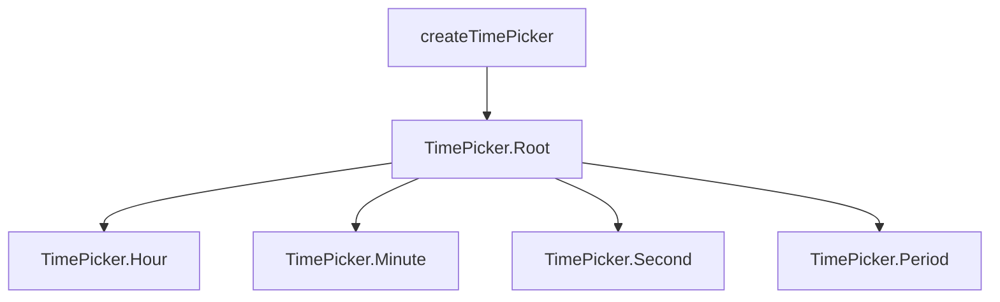

# TimePicker

<DocsPageFeatures :frontmatter />

Edit a time as hour, minute, and optional second fields. The control stores a 24-hour string, and 12-hour mode adds an AM/PM field.

## Usage

Each field is a spinbutton. Arrow keys step the focused field. The model stays empty until the hour and the minute are both set.

::: gn-example
/components/time-picker/basic
:::

## Anatomy

```vue Anatomy no-filename
<script setup lang="ts">
  import { TimePicker } from '@vuetify/v0'
</script>

<template>
  <TimePicker.Root>
    <TimePicker.Hour />

    <TimePicker.Minute />

    <TimePicker.Second />

    <TimePicker.Period />
  </TimePicker.Root>
</template>
```

## Architecture

Root owns the time value. Hour, Minute, Second, and Period read that value and step one field each. Second renders only when `seconds` is set. Period renders only when `hour-cycle` is `h12`.



## Examples

::: gn-example
/components/time-picker/office.ts 1
/components/time-picker/office.vue 2

### Office hours

A 12-hour picker bounded to a workday. The hour field shows 1 through 12, and the period field shows AM or PM. The model is still a 24-hour string, so 9 AM is `09:00` and 5 PM is `17:00`.

`min` and `max` clamp a complete value. The bounds live in `office.ts` as `09:00` and `17:00`. Step the hour up from 5 PM and the next hour is `18:00`, then the upper bound pulls the value back to `17:00`. Switch 9 AM to PM and the stored hour shifts by 12, from `09:00` to `21:00`, and the same bound pulls it back to `17:00`.

Seconds stay off, so the second field is not in the tree. Arrow keys step whichever field has focus. The period field toggles AM and PM on either arrow.

| File | Role |
|------|------|
| `office.ts` | Open and close bounds |
| `office.vue` | 12-hour picker and the stored value |
:::

## Recipes

### Quarter hours

`minute-step` snaps the minute field. A step of 15 moves 00, 15, 30, 45.

```vue
<template>
  <TimePicker.Root v-model="value" :minute-step="15">
    <TimePicker.Hour v-slot="{ text }">{{ text }}</TimePicker.Hour>
    <TimePicker.Minute v-slot="{ text }">{{ text }}</TimePicker.Minute>
  </TimePicker.Root>
</template>
```

### Submit with a form

Set `name` and Root renders a hidden input with the 24-hour value. You do not place `TimePicker.HiddenInput` yourself.

```vue
<template>
  <form>
    <TimePicker.Root v-model="value" name="alarm">
      <TimePicker.Hour v-slot="{ text }">{{ text }}</TimePicker.Hour>
      <TimePicker.Minute v-slot="{ text }">{{ text }}</TimePicker.Minute>
    </TimePicker.Root>
  </form>
</template>
```

## Accessibility

Root renders `role="group"` with an accessible name from the `label` prop, or from the locale catalog when `label` is omitted. Each field renders `role="spinbutton"`.

### ARIA attributes

| Attribute | Value | Notes |
|-----------|-------|-------|
| `role` | `group` | Root |
| `role` | `spinbutton` | Hour, Minute, Second, Period |
| `aria-label` | Locale string | Group name, and one name per field |
| `aria-valuenow` | Current number | Omitted while that field is empty |
| `aria-valuemin` | `0` or `1` | Hour is 0–23 in 24-hour mode and 1–12 in 12-hour mode. Minute and second are 0–59. Period is 0. |
| `aria-valuemax` | `23`, `12`, `59`, or `1` | Matches the field and the hour cycle |
| `aria-valuetext` | `AM` or `PM` | Period field |
| `aria-disabled` | `true` or `false` | Non-button hosts. A native button uses `disabled` and omits `aria-disabled`. |

### Keyboard

| Key | Action |
|-----|--------|
| `ArrowUp` | Step the focused field up |
| `ArrowDown` | Step the focused field down |

The period field toggles AM and PM on either arrow. Disabled and readonly fields do not change the value.

### Data attributes

| Attribute | Values | Components |
|-----------|--------|------------|
| `data-part` | `hour`, `minute`, `second`, `period` | Fields |
| `data-disabled` | `true` | Root and fields |
| `data-readonly` | `true` | Root and fields |

## FAQ

::: faq

??? When does v-model get a string?

The model stays null until the hour and the minute are both set. With `seconds`, the second must be set too. A partial edit does not publish a string.

??? Why does 12-hour mode still store 15:00?

The stored value is always 24-hour. The hour field shows 1 through 12, and the period field shifts that hour by 12. 12 AM is 00 and 12 PM is 12.

??? What do min and max do?

They clamp a complete value into the window. An incomplete value stays null. Bounds use the same hour-minute form as the model, and they include seconds only when seconds are on.

??? Which keys move a field?

ArrowUp steps up. ArrowDown steps down. The period field toggles AM and PM. Disabled and readonly fields keep the current value.

:::

<DocsApi />
