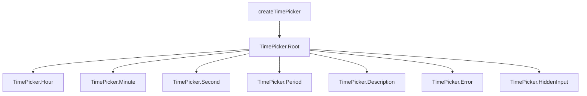

# TimePicker

<DocsPageFeatures :frontmatter />

Edit a time as hour, minute, and optional second fields. The control stores a 24-hour string, and 12-hour mode adds an AM/PM field.

## Usage

Each field is a spinbutton, moved from the keyboard with the arrow, Page, Home, and End keys. The model stays null until the hour and the minute are both set.

::: gn-example
/components/time-picker/basic
:::

## Anatomy

```vue Anatomy no-filename
<script setup lang="ts">
  import { TimePicker } from '@vuetify/v0'
</script>

<template>
  <TimePicker.Root>
    <TimePicker.Hour />

    <TimePicker.Minute />

    <TimePicker.Second />

    <TimePicker.Period />

    <TimePicker.Description />

    <TimePicker.Error />

    <TimePicker.HiddenInput />
  </TimePicker.Root>
</template>
```

## Architecture

Root owns the time value. Hour, Minute, Second, and Period each read and edit one field of it. Second renders only when `seconds` is set. Period renders only when `hour-cycle` is `h12`. Description and Error hold the help text and the validation messages, and Root links the fields to them. HiddenInput carries the displayed time into a form, and Root renders it when `name` is set.



## Examples

::: gn-example
/components/time-picker/office.ts 1
/components/time-picker/office.vue 2

### Office hours

A 12-hour picker bounded to a workday. The hour field shows 1 through 12, and the period field shows AM or PM. The model is still a 24-hour string, so 9 AM is `09:00` and 5 PM is `17:00`.

`min` and `max` keep a complete value inside the window. The bounds live in `office.ts` as `09:00` and `17:00`. Step the hour up from 5 PM and the next hour is `18:00`, then the upper bound pulls the value back to `17:00`. Switch 9 AM to PM and the stored hour shifts by 12, from `09:00` to `21:00`, and the same bound pulls it back to `17:00`. The hour stays inside its half of the day, so ArrowUp on 11 AM wraps to 12 AM, which is `00:00`, and the lower bound pulls that up to `09:00`.

Seconds stay off, so the second field is not in the tree. Focus a field and use the keys listed under [Keyboard Navigation](#keyboard-navigation). On the period field, either arrow toggles AM and PM.

| File | Role |
|------|------|
| `office.ts` | Open and close bounds |
| `office.vue` | 12-hour picker and the stored value |
:::

::: gn-example
/components/time-picker/validation

### Validation

A required picker inside a [Form](/components/forms/form). The Book button calls `submit` from the Form's slot, which validates every field in the form. Press it with a field still empty and the submit fails: the model is null, so `required` rejects it, the fields get `aria-invalid`, and `TimePicker.Error` shows the message. Set both fields and the submit passes, unless the time is `12:00`, which the rule in `rules` turns down.

`TimePicker.Description` holds the help text. While it is mounted, Root and every field point at it with `aria-describedby`. The border color comes from `data-state` on Root, which reads `pristine`, `valid`, or `invalid`.
:::

## Validation

Root takes `required`, `rules`, `error`, and `errorMessages`, and registers with a parent [Form](/components/forms/form), so a form submit validates the picker. The validated value is the model: a 24-hour string, or null while a field is empty. Each rule receives it and returns `true`, or a message.

`validateOn` sets when the picker validates on its own. It defaults to `'blur'`, and takes the same values as [Input](/components/forms/input): `'blur'`, `'input'`, or `'submit'`, optionally with `lazy` or `eager`. The picker counts as blurred when focus leaves the group. Focus moving from one field to another is not a blur, so a required picker does not report an error while you tab from the hour to the minute. `'input'` validates when a key changes the time and when a value is set from outside, as [NumberField](/components/forms/number-field) does. A value from outside is validated once, in the form the picker settles on after applying the step and the bounds. The picker normalizing on its own, at mount, when `disabled` or `readonly` is lifted, or when a step or a bound changes, is input only once the picker has a validity: the new value is then validated too, so the state on show does not go stale. A validity comes from a validation, or from `error` or `errorMessages`, which set one without a validation having run. A picker that has no validity yet stays that way, and the slot's `reset` is not input. Both hold for a parent that answers an update at once. One that accepts late is read as a value from outside, which is input: see [What if the parent refuses an update?](#faq). A normalization that lands while the first async validation is still pending is not input, so that result describes the earlier value. A disabled picker does not validate from focus, and focus inside it does not set `data-focused` until it is enabled.

`required` and `rules` are read once, when Root is set up. Changing them later has no effect.

`error` forces the invalid state, and `errorMessages` are shown ahead of the messages the rules produce.

The Root slot exposes `errors`, `isValid`, `isPristine`, `isFocused`, `validate`, and `reset`. A value the picker moved onto the step or inside the bounds is still pristine. `reset` puts the initial value back, drops a partly entered time, and clears the validation state. While the picker is disabled or readonly it does not emit: it clears the validation state and leaves the time alone. `isPristine` reads true after a reset even when the parent refuses the value.

## Recipes

### Quarter hours

`minute-step` keeps the minute on the multiples of the step. With a step of 15, ArrowUp moves 00, 15, 30, 45 and wraps to 00, and ArrowDown runs the other way. A value that arrives off the grid moves to the nearest multiple without wrapping and is written back, so `09:50` becomes `09:45`. `hour-step` and `second-step` work the same way.

```vue
<template>
  <TimePicker.Root v-model="value" :minute-step="15">
    <TimePicker.Hour v-slot="{ text }">{{ text }}</TimePicker.Hour>
    <TimePicker.Minute v-slot="{ text }">{{ text }}</TimePicker.Minute>
  </TimePicker.Root>
</template>
```

### Bounds and steps together

A complete value outside `min` and `max` moves to the nearest time inside them that is also on every field's step. With `minute-step="15"`, `min="10:07"` starts the range at `10:15`, and `max="17:10"` ends it at `17:00`. Only when no such time lies between the bounds is the step set aside, and the value is clamped to the bound itself.

```vue
<template>
  <TimePicker.Root v-model="value" max="17:10" min="10:07" :minute-step="15">
    <TimePicker.Hour v-slot="{ text }">{{ text }}</TimePicker.Hour>
    <TimePicker.Minute v-slot="{ text }">{{ text }}</TimePicker.Minute>
  </TimePicker.Root>
</template>
```

### Submit with a form

Set `name` and Root renders `TimePicker.HiddenInput` for you. The input submits the time the fields show as a 24-hour string, and an empty string while a field is empty. Set `form` to the id of a form when Root sits outside it.

Do not also place `TimePicker.HiddenInput` yourself. Inside a Root that has `name` it submits the value a second time, and inside a Root without `name` it has no name and submits nothing.

- A readonly picker still submits. It sends the time the fields show, which is an empty string when the model holds a string that is not a time.
- A disabled picker is left out of the submission.
- A native form reset does not restore the picker. A [Form](/components/forms/form) reset clears its validation state and leaves the time alone. Call `reset` from the Root slot to put the initial value back.

```vue
<template>
  <form>
    <TimePicker.Root v-model="value" name="alarm">
      <TimePicker.Hour v-slot="{ text }">{{ text }}</TimePicker.Hour>
      <TimePicker.Minute v-slot="{ text }">{{ text }}</TimePicker.Minute>
    </TimePicker.Root>
  </form>
</template>
```

### Two pickers on one page

Every Root is named "Time" by default, and every field "Hour", "Minute", "Second", or "AM/PM", from the locale catalog. Give a start and an end picker their own names with `ariaLabel`, or point `ariaLabelledby` at a visible label. Both props exist on Root and on each field, and `ariaLabelledby` replaces `ariaLabel`.

Each field's id is generated from the Root id and the field's kind. Two fields of the same kind inside one Root, such as a mobile and a desktop Hour, would share that id, so pass `id` to each.

```vue
<template>
  <span id="start-label">Start</span>

  <TimePicker.Root v-model="start" aria-labelledby="start-label">
    <TimePicker.Hour v-slot="{ text }" aria-label="Start hour">{{ text }}</TimePicker.Hour>
    <TimePicker.Minute v-slot="{ text }" aria-label="Start minute">{{ text }}</TimePicker.Minute>
  </TimePicker.Root>

  <TimePicker.Root v-model="end" aria-label="End time">
    <TimePicker.Hour v-slot="{ text }" aria-label="End hour">{{ text }}</TimePicker.Hour>
    <TimePicker.Minute v-slot="{ text }" aria-label="End minute">{{ text }}</TimePicker.Minute>
  </TimePicker.Root>
</template>
```

### Clear the value

The Root slot exposes `clear`, which empties every field and sets the model to null. It does nothing while the picker is disabled or readonly.

```vue
<template>
  <TimePicker.Root v-slot="{ clear }" v-model="value">
    <TimePicker.Hour v-slot="{ text }">{{ text }}</TimePicker.Hour>
    <TimePicker.Minute v-slot="{ text }">{{ text }}</TimePicker.Minute>

    <Button.Root @click="clear">Clear</Button.Root>
  </TimePicker.Root>
</template>
```

### Data Attributes

Style field and interaction states without slot props:

| Attribute | Values | Components |
|-----------|--------|------------|
| `data-part` | `hour`, `minute`, `second`, `period` | Hour, Minute, Second, Period |
| `data-state` | `empty`, `filled` | Hour, Minute, Second. Period is always `filled` |
| `data-state` | `pristine`, `valid`, `invalid` | Root. `pristine` until the first validation |
| `data-dirty` | `true` | Root, while the model holds a value |
| `data-focused` | `true` | Root, while one of the fields has focus and the picker is not disabled |
| `data-complete` | `true` | Root, while the fields show a complete time |
| `data-disabled` | `true` | Root, Hour, Minute, Second, Period |
| `data-readonly` | `true` | Root, Hour, Minute, Second, Period |

## Accessibility

Root renders `role="group"`. Each field renders `role="spinbutton"` per the [WAI-ARIA Spinbutton pattern](https://www.w3.org/WAI/ARIA/apg/patterns/spinbutton/). Names come from the locale catalog unless you pass `ariaLabel` or `ariaLabelledby`.

### ARIA Attributes

| Attribute | Value | Notes |
|-----------|-------|-------|
| `role` | `group` | Root |
| `role` | `spinbutton` | Hour, Minute, Second, Period |
| `aria-label` | Label text | Root and fields. The `ariaLabel` prop, or the locale string. Omitted when `ariaLabelledby` is set |
| `aria-labelledby` | Element id | Root and fields, from the `ariaLabelledby` prop |
| `aria-describedby` | Element ids | Root: the `ariaDescribedby` prop, then the Description while one is mounted. Fields: the Description |
| `aria-required` | `true` | Fields, when Root is `required` |
| `aria-invalid` | `true` | Fields, while validation has failed or `error` is set |
| `aria-errormessage` | Element id | Fields, while an Error is mounted and there are messages |
| `aria-valuenow` | Current number | Absent while the field is empty. Period is `0` for AM and `1` for PM |
| `aria-valuemin` | Lowest value the field can show | Follows the step, and in 12-hour mode the current AM or PM half. Period is `0` |
| `aria-valuemax` | Highest value the field can show | Follows the step, and in 12-hour mode the current AM or PM half. Period is `1` |
| `aria-valuetext` | `AM` or `PM` | Period |
| `aria-valuetext` | Hour and period, such as `3 PM` | Hour in 12-hour mode, while it has a value. The 24-hour hour, the minute, and the second have none |
| `aria-readonly` | `true` | Fields, when Root is `readonly` |
| `aria-disabled` | `true` or `false` | Root and fields. Omitted on a native button host, which uses `disabled` |

With the default steps the hour runs 0–23, or 1–12 in 12-hour mode, and the minute and second run 0–59. A step narrows the range to its multiples: `minute-step="15"` gives a minute range of 0–45. While Root is `disabled` or `readonly` the fields report their whole range instead, because the value is shown as given and may sit off the step.

The reported range always includes the value the field shows. When that value is off the step, the range widens to take it in.

The `min` and `max` props do not narrow `aria-valuemin` and `aria-valuemax`. They apply to the whole time, not to one field. At a bound, a key that would take the time out of the range leaves it unchanged.

Each field is a tab stop. Disabled fields use `tabindex="-1"`. Readonly fields stay focusable.

Keep the fields on a non-button element. `as="button"` is not a suitable host: `role="spinbutton"` is not an allowed role on `<button>` in ARIA in HTML, and axe reports it as `aria-allowed-role`.

### Keyboard Navigation

Hour, Minute, and Second:

| Key | Action |
|-----|--------|
| `ArrowUp` | Move up one interval. Wraps past the highest value |
| `ArrowDown` | Move down one interval. Wraps past the lowest value |
| `PageUp` | Move the hour up about 2 hours, or the minute or second up about 15, in whole intervals and never less than one |
| `PageDown` | Move the hour down about 2 hours, or the minute or second down about 15, in whole intervals and never less than one |
| `Home` | Set the lowest value the field can show |
| `End` | Set the highest value the field can show |
| `Backspace` / `Delete` | Clear the field. The model becomes null |

An empty field lands on its first value on any arrow or Page key. In 12-hour mode the hour field counts in display numbers, so `Home` sets 1 and `End` sets 12 with the default step.

Period:

| Key | Action |
|-----|--------|
| `ArrowUp` / `ArrowDown` | Toggle AM and PM |
| `PageUp` / `PageDown` | Toggle AM and PM |
| `Home` | Set AM |
| `End` | Set PM |

`Backspace` and `Delete` do nothing on Period. Typing digits into a field is not supported.

Every key is ignored while Root is `disabled` or `readonly`. An ignored key keeps its browser default, so the arrow keys, Page, Home, and End scroll the page from a focused readonly field.

### Locale Keys

The names and spoken text come from [useLocale](/composables/plugins/use-locale). Without the locale plugin, or without a translation for a key, the English default is used.

| Key | Default | Used for |
|-----|---------|----------|
| `TimePicker.label` | `Time` | Root `aria-label` |
| `TimePicker.hour` | `Hour` | Hour `aria-label` |
| `TimePicker.minute` | `Minute` | Minute `aria-label` |
| `TimePicker.second` | `Second` | Second `aria-label` |
| `TimePicker.period` | `AM/PM` | Period `aria-label` |
| `TimePicker.am` | `AM` | Period text and `aria-valuetext` |
| `TimePicker.pm` | `PM` | Period text and `aria-valuetext` |
| `TimePicker.hourText` | `{hour} {period}` | `aria-valuetext` of the hour in 12-hour mode. A locale can reorder the two parts |
| `Input.required` | `Required` | Message of the `required` rule |

An `ariaLabel` or `ariaLabelledby` prop takes priority over the label keys.

The digits a field shows are formatted by the locale's `n()` and padded to two digits with the locale's zero. The hour in a 12-hour `aria-valuetext` goes through `n()` too, without padding. Under a locale with its own numerals, such as `ar-EG`, the fields show those. The model, the Root slot's `value`, and the submitted value stay in Latin digits.

## FAQ

::: faq

??? When does v-model get a string?

The model stays null until the hour and the minute are both set. With `seconds`, a time entered field by field also needs the second. A value that arrives as `HH:mm` while `seconds` is on reads as second 00, so `09:30` becomes `09:30:00`, and turning `seconds` on for a picker whose hour and minute are set keeps the time with second 00. Clearing any field sets the model back to null.

??? Why does 12-hour mode still store 15:00?

The stored value is always 24-hour. The hour field shows 1 through 12, and the period field shifts that hour by 12. 12 AM is 00 and 12 PM is 12.

??? What do min and max do?

They keep a complete value inside the window. An incomplete value stays null. A value outside the window moves to the nearest time inside it that is on every field's step, so with `minute-step="15"` and `min="10:07"` the earliest value is `10:15`. If no such time lies between the bounds, the value is clamped to the bound itself. Bounds use the same 24-hour form as the model, and their seconds count only when `seconds` is on.

??? What do disabled and readonly do?

Both ignore every key and `clear`, and the picker never emits while either is set, not even from the slot's `reset`. An ignored key keeps its browser default, so the arrow keys, Page, Home, and End scroll the page. The value is shown as given, without the step or `min` and `max` applied. When the picker is editable again it applies them and emits the result. `disabled` also takes the fields out of the tab order and keeps the hidden input out of form submission. `readonly` keeps the fields focusable, sets `aria-readonly`, and still submits the displayed time.

??? What if the parent refuses an update?

The fields follow the model. When the parent does not accept an emitted value, the fields take the model's value as given, without the step or the bounds applied, and the picker emits nothing more. The parent sees one `update:modelValue`. The fields return to the model's time once the picker has checked the parent's answer, on the render that follows, so wait for the DOM to update rather than for a fixed number of ticks.

When the parent replaces the emitted value with a different one, the picker treats the replacement as an incoming value: it normalizes it and emits the result once. If the parent changes that too, the picker takes the parent's value as given and stops. One edit emits at most twice.

The same holds on mount. A picker that normalizes its initial value emits once, and a parent that replaces that value with a different one gets one more emit a tick later. A parent that only refuses gets one.

A key pressed while the fields show a value taken as given edits what they show. The field moves by the usual rules, then the whole time is normalized and emitted once: with `minute-step="15"` and fields showing `04:50`, ArrowDown gives `04:45`.

Two things follow:

- Accept or refuse synchronously. A parent that accepts late, after a timer, a debounce, or an awaited request, looks like a refusal until its value arrives. The fields show the old time in between, and each rapid key press starts from it. Bind the picker to a local ref and debounce or validate downstream of that ref.
- Give the picker the same step the parent rounds to. A parent that rounds to 30 minutes over a picker with the default `minute-step` gets `09:01` on ArrowUp and maps it straight back, so the field returns to `09:00` every time. With `minute-step="30"` the picker emits `09:30`.

??? Why does the Root slot value differ from the model?

The Root slot's `value` is the time the fields show. It differs from the model only when the model holds a string the fields cannot show as written: a string that is not a time, or a time with or without seconds against the `seconds` setting that the picker has not rewritten, because it is disabled or readonly or because it took a parent's value as given.

??? Can I type digits into a field?

No. Fields move with the arrow, Page, Home, and End keys, and clear with Backspace or Delete. See [Keyboard Navigation](#keyboard-navigation).

:::

<DocsApi />
