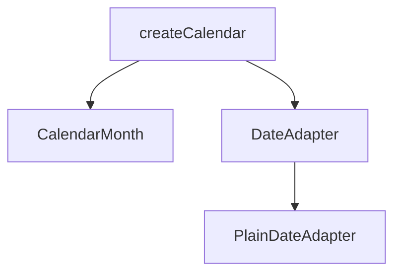

# createCalendar

<DocsPageFeatures :frontmatter />

A Gregorian month grid with single and range selection. Days outside the minimum and maximum are disabled, and a separate predicate marks days unavailable.

## Usage

```ts collapse
import { createCalendar } from '@vuetify/v0'

const calendar = createCalendar({
  month: '2026-08',
  min: '2026-08-10',
  unavailable: iso => iso === '2026-08-15',
})

calendar.select('2026-08-12')
calendar.month.value.weeks
calendar.today() // pages to today and selects nothing
```

## Architecture

`createCalendar` owns the visible month, the focused day, and the selection. Date math goes through a `DateAdapter`. With no adapter, and no date plugin installed, that adapter is a plain JavaScript `Date`.



## Options

| Option | Type | Default | Purpose |
| - | - | - | - |
| `mode` | `'single' \| 'range'` | `'single'` | One day, or a start and end |
| `month` | `YYYY-MM` | current month | Visible month. A ref is written back when the grid pages |
| `value` | ISO day or `{ start, end }` | unset | Selection. A ref is written back |
| `min` / `max` | `YYYY-MM-DD` | unset | Days outside the range are disabled |
| `disabled` | `boolean` | `false` | Disables every day. Paging still runs |
| `unavailable` | `(iso) => boolean` | unset | Per-day rejection, separate from disabled |
| `readonly` | `boolean` | `false` | `select` no-ops. Days are not marked disabled |
| `firstDayOfWeek` | `0–6` | adapter locale | Sunday is `0`. Does not write the adapter |
| `fixedWeeks` | `boolean` | `false` | Pad the grid to six rows |
| `preventDeselect` | `boolean` | `false` | A second click keeps the day |
| `locale` | string | adapter default | Applied only when this call owns the adapter |
| `weekdayFormat` | `'long' \| 'short' \| 'narrow'` | `'narrow'` | Column labels |

Pass `adapter` to use a date engine you already have. An adapter you pass is not replaced.

## Reactivity

| Property | Reactive | Notes |
| - | :-: | - |
| `month` | <AppSuccessIcon /> | One month object. `weeks` is the cell grid |
| `weekdays` | <AppSuccessIcon /> | Seven labels, rotated to `firstDayOfWeek` |
| `label` | <AppSuccessIcon /> | Localized month and year |
| `anchor` | <AppSuccessIcon /> | Visible month, `YYYY-MM` |
| `focused` | <AppSuccessIcon /> | Day the grid is on. May be disabled |
| `value` | <AppSuccessIcon /> | Selected day, or `{ start, end }` |
| `isFirst` / `isLast` | <AppSuccessIcon /> | Visible month is against `min` or `max` |
| `select` / `today` / `move` | <AppErrorIcon /> | Methods |

`today()` pages to the current month and focuses today. It does not select. `selectToday()` selects today when that day is allowed.

## Examples

::: gn-example
/composables/create-calendar/basic

### One month, two kinds of closed days

August 2026 is pinned so the preview does not depend on today's date. The 10th is the minimum, so earlier days are disabled. The 15th and 16th are unavailable: booked, not out of range. A click calls `select`. Disabled, unavailable, and spill days stay unselected. Prev and next page the month. `value` is the ISO day.

`fixedWeeks` is off, so the grid is only as tall as the month. Pass `mode: 'range'` on the same composable when you need a start and an end. A second click clears a single selection unless `preventDeselect` is set.

| File | Role |
| - | - |
| `basic.vue` | Month grid bound to `createCalendar` |
:::

## FAQ

::: faq
??? Does today select the current day?

No. `today()` moves the visible month and the focused day. `selectToday()` selects today when the day is in month and neither disabled nor unavailable.

??? What is the difference between disabled and unavailable?

`min`, `max`, and the whole-control `disabled` flag mark a day disabled. `unavailable` is your predicate. A day can be both. Selection refuses either one. Focus can still land on a disabled day inside the month.

??? Why is month not an array?

The grid is one month. `month` is that month. A length-1 list would only pretend to be a multi-month calendar.
:::

<DocsApi />
