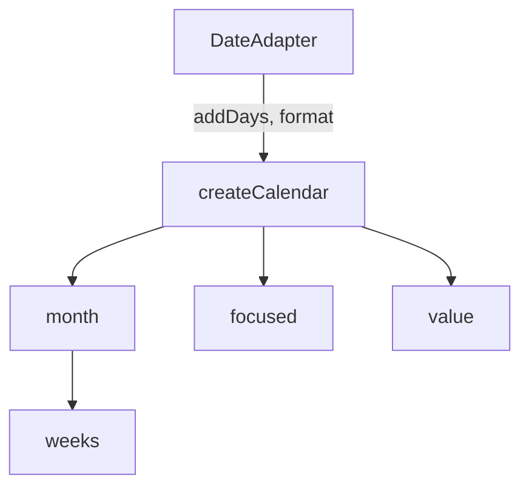

# createCalendar

<DocsPageFeatures :frontmatter />

A Gregorian month grid with single and range selection. Days outside the minimum and maximum are disabled, and `disabled` can name individual days.

## Usage

```ts collapse
import { createCalendar } from '@vuetify/v0'

const calendar = createCalendar({
  month: '2026-08',
  min: '2026-08-10',
  disabled: iso => iso === '2026-08-15',
})

calendar.select('2026-08-12')
calendar.month.value.weeks
calendar.today() // pages to today and selects nothing
```

## Adapters

Inside a component, an omitted `adapter` comes from the installed [date plugin](/composables/plugins/use-date). [useDate](/composables/plugins/use-date) reads that same context, so both share its [DateAdapter](/composables/plugins/use-date#dateadapter-interface), locale, and week start. The grid does not call `useDate()`. That call throws outside a component. There, or with no plugin, the grid constructs a [PlainDateAdapter](/composables/plugins/use-date#adapters). It does not install the plugin.

The first match wins:

| Source | What the grid uses |
| - | - |
| The `adapter` argument | That instance. This call does not write its locale or its week start, and it does not read the plugin |
| An installed date plugin, inside a component | That plugin's adapter, locale, and week start. This is the context `useDate()` returns |
| Nothing installed, or a call outside a component | A new `PlainDateAdapter`, a JavaScript `Date`. `useDate()` throws outside a component. This call does not |

`locale` is applied only in the last case. `firstDayOfWeek` overrides the week start for this grid and is not written back onto a borrowed adapter.

Weeks are built with `addDays` from that week start. The grid does not call `getWeekArray`. Column labels are `Intl` weekday names in the resolved locale. The month title uses the adapter's `monthAndYear` format. On the public surface a month is `YYYY-MM` and a day is `YYYY-MM-DD`. The adapter's own value, a `Date` or a Temporal date, stays inside the grid.

| Adapter | Import | Role here |
| - | - | - |
| `PlainDateAdapter` | `@vuetify/v0` | Default when this call owns the engine |
| `V0DateAdapter` | `@vuetify/v0/date` | Temporal. Pass it, or install the date plugin with it |
| A `DateAdapter` subclass | Your module | Pass it, or install it on the plugin |

Writing a subclass is covered on the [useDate](/composables/plugins/use-date) page.

::: code-group

```ts Plugin
import { createCalendar, createDatePlugin } from '@vuetify/v0'
import { V0DateAdapter } from '@vuetify/v0/date'

app.use(
  createDatePlugin({
    adapter: new V0DateAdapter(),
    locale: 'en-US',
  }),
)

// In a component. useDate() borrows this adapter too.
const calendar = createCalendar({ firstDayOfWeek: 1 })
```

```ts Direct
import { createCalendar } from '@vuetify/v0'
import { V0DateAdapter } from '@vuetify/v0/date'

// Skips the plugin, even when one is installed.
const calendar = createCalendar({
  adapter: new V0DateAdapter(),
})
```

:::

## Architecture

`month`, `focused`, and `value` stay on the grid. Day math and the month title go through the [DateAdapter](/composables/plugins/use-date#dateadapter-interface). Weeks are built with `addDays` from the week start.



## Options

| Option | Type | Default | Purpose |
| - | - | - | - |
| `mode` | `'single' \| 'range'` | `'single'` | One day, or a start and end. A ref is read live. Inside a component, changing it clears the selection |
| `month` | `YYYY-MM` | current month | Visible month. A ref is written back when the grid pages, and when `min` or `max` clamps the month it started on |
| `value` | ISO day or `{ start, end }` | unset | Selection. A ref is written back |
| `min` / `max` | `YYYY-MM-DD` | unset | Days outside the range are disabled |
| `disabled` | `boolean \| string[] \| (iso) => boolean` | `false` | `true` disables every day. An array of `YYYY-MM-DD` days, or a function, disables the days it names. Paging still runs |
| `readonly` | `boolean` | `false` | `select` no-ops. Days are not marked disabled |
| `firstDayOfWeek` | `0–6` | adapter locale | Sunday is `0`. Does not write the adapter |
| `fixedWeeks` | `boolean` | `false` | Pad the grid to six rows |
| `mandatory` | `boolean` | `false` | In single mode a second click keeps the day. `unselect()` does nothing |
| `locale` | string | adapter default | Applied only when this call owns the adapter |
| `namespace` | string | `'v0:date'` | Date plugin to borrow when `adapter` is omitted |
| `weekdayFormat` | `'long' \| 'short' \| 'narrow'` | `'narrow'` | Column labels |

### Selection

Single mode stores one `YYYY-MM-DD` string. A second click on that day clears it, unless `mandatory` is set. `unselect()` clears it too, and also does nothing when `mandatory` is set. Writing the `value` ref from outside still replaces the day.

Range mode stores `{ start, end }`.

- The first click sets `start`.
- While the range is open, a click on or after `start` sets `end`.
- A click before `start` moves `start` and leaves the range open. It does not swap the ends.
- A click once both ends exist starts a new range at that day.
- An open range (`start` and no `end`) completes on a click on or after `start`. A click before `start` moves `start`.

`mode` may be a ref or a getter. Inside a component, switching it clears the selection and writes that empty value back. `mandatory` does not keep the previous day. The next click starts in the new mode.

`select` refuses a spill day and a disabled day. A spill day before year 0000 or after year 9999 is disabled, because it is not a `YYYY-MM-DD` day. Days between the ends can still be disabled. `readonly` makes `select` and `unselect` do nothing, and it does not mark cells disabled. Paging still runs.

## Reactivity

| Property | Reactive | Notes |
| - | :-: | - |
| `month` | <AppSuccessIcon /> | One month object. `weeks` is the cell grid |
| `weekdays` | <AppSuccessIcon /> | Seven labels, rotated to `firstDayOfWeek` |
| `label` | <AppSuccessIcon /> | Localized month and year |
| `anchor` | <AppSuccessIcon /> | Visible month, `YYYY-MM` |
| `focused` | <AppSuccessIcon /> | Day the grid is on. May be disabled |
| `value` | <AppSuccessIcon /> | Selected day, or `{ start, end }` |
| `isFirst` / `isLast` | <AppSuccessIcon /> | Visible month is against `min`, `max`, or the first or last representable month |
| `select` / `today` / `move` | <AppErrorIcon /> | Methods |

`today()` pages to the current month and focuses today. It does not select. `selectToday()` selects today when that day is allowed.

When the grid borrows a date plugin, `label` and `weekdays` follow that plugin's locale, and the week start follows the plugin unless `firstDayOfWeek` is set. When this call owns the adapter, a `locale` ref does the same for the title, the labels, and the week columns. The title for year 0000 follows Intl, which numbers that year 1. In the browser, the today marker moves at local midnight.

## Examples

::: gn-example
/composables/create-calendar/month.ts 1
/composables/create-calendar/CalendarGrid.vue 2
/composables/create-calendar/basic.vue 3

### A range across closed days

The grid opens on the current month. The 12th through the 20th start selected. The 10th is the minimum, so earlier days are disabled. The 15th and 16th are disabled and sit inside that range. Today has a rounded outline.

The first and last days use a solid primary fill and on-primary text. Days between them use a primary tint. A click starts a new range, and the next click sets the end. Disabled and spill days cannot become an endpoint. `value` is `{ start, end }`.

Single and Range switch `mode` on the same grid. The switch clears the selection. Single mode then selects one day, and a second click clears it unless `mandatory` is set. `fixedWeeks` is off, so the grid is only as tall as the month. Prev and next page the month.

| File | Role |
| - | - |
| `month.ts` | Current-month dates, the caption, and the range marks |
| `CalendarGrid.vue` | Month title, paging, and the day buttons |
| `basic.vue` | Creates the calendar, switches mode, and reads the caption |
:::

## FAQ

::: faq
??? Does today select the current day?

No. `today()` moves the visible month and the focused day. `selectToday()` selects today when the day is in month and not disabled. Focus can still land on a disabled day.

??? Why is month not an array?

The grid is one month. `month` is that month. A length-1 list would only pretend to be a multi-month calendar.

??? Does createCalendar use an installed date plugin?

Yes. Inside a component it reads the same context `useDate()` returns. It does not call `useDate()`, because that throws outside a component. With no plugin, the grid uses `PlainDateAdapter` and does not throw. The order is in [Adapters](#adapters).

??? Are selected days Date objects?

No. The visible month is `YYYY-MM`. A selected day, `min`, `max`, and each entry in a `disabled` list are `YYYY-MM-DD`. The adapter's own value stays inside the grid.

??? Does the grid call getWeekArray?

No. Weeks are built with `addDays` from `firstDayOfWeek`. The [useDate](/composables/plugins/use-date) month example calls `getWeekArray` on the adapter directly, so that method is visible. That example is not this grid.

??? Does changing mode keep the selected days?

No. Switching `mode` clears the selection and writes the empty value back. The next click starts in the new mode.

??? Does a second click clear a range?

No. In range mode a click after both ends exist starts a new range at that day. In single mode a second click clears the day, unless `mandatory` is set.

??? Does the grid handle arrow keys?

No. Keyboard handling belongs on a component. The grid exposes `move`, `step`, `goto`, `next`, `prev`, `first`, and `last`.
:::

<DocsApi />
