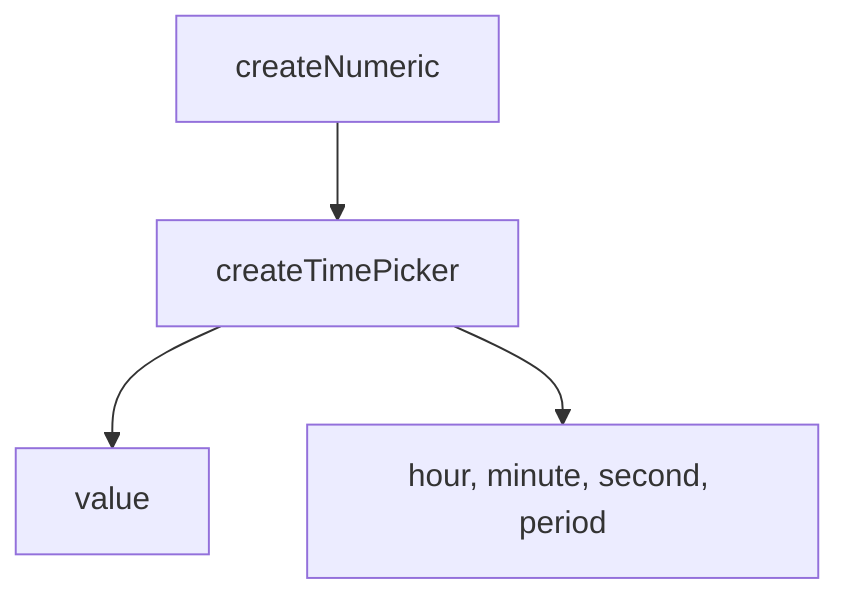

# createTimePicker

<DocsPageFeatures :frontmatter />

Keep a time as separate hour, minute, and optional second fields. The public value stays null until every enabled field has a number.

## Usage

```ts collapse
import { shallowRef } from 'vue'
import { createTimePicker } from '@vuetify/v0'

const value = shallowRef<string | null>(null)
const time = createTimePicker({ value, minuteStep: 15 })

time.setHour(9)
time.value.value // null. The minute is still empty.

time.setMinute(30)
time.value.value // '09:30'

time.stepMinute(1)
time.value.value // '09:45'

const afternoon = createTimePicker({
  hourCycle: 'h12',
  value: shallowRef('15:00'),
})

afternoon.hour.value // 3
afternoon.period.value // 'pm'
afternoon.setPeriod('am')
afternoon.value.value // '03:00'
```

## Architecture

`createTimePicker` owns the fields and the canonical string. Each snap and step delegates the numeric work to `createNumeric`. The composable does not touch the DOM.



## Options

| Option | Default | What it does |
|--------|---------|--------------|
| `value` | a new empty ref | Canonical 24-hour string, or null |
| `hourCycle` | `'h23'` | `'h12'` shows 1–12 and a period. Any other value is read as `'h23'` |
| `seconds` | `false` | When true, the string includes seconds and the second field must be set |
| `hourStep` | `1` | Hour snap interval. A non-finite or non-positive step is read as 1 |
| `minuteStep` | `1` | Minute snap interval |
| `secondStep` | `1` | Second snap interval |
| `min` | none | Inclusive lower bound, `HH:mm` or `HH:mm:ss` |
| `max` | none | Inclusive upper bound, same form as `min` |
| `disabled` | `false` | Mutations no-op, including `clear` |
| `readonly` | `false` | Mutations no-op, including `clear` |

`hourCycle`, `seconds`, the steps, `min`, `max`, `disabled`, and `readonly` accept a `MaybeRefOrGetter`. `value` is a `Ref<string | null>`.

## Reactivity

| Property / method | Reactive | Notes |
| - | :-: | - |
| `value` | <AppSuccessIcon /> | 24-hour string, or null while a field is empty |
| `hour` | <AppSuccessIcon /> | 0–23 in `h23`, 1–12 in `h12`, or null |
| `minute` | <AppSuccessIcon /> | 0–59, or null |
| `second` | <AppSuccessIcon /> | 0–59, or null when seconds are off or unset |
| `period` | <AppSuccessIcon /> | `'am'` or `'pm'` in `h12`, null in `h23` |
| `hourCycle` | <AppSuccessIcon /> | Resolved cycle |
| `seconds` | <AppSuccessIcon /> | Whether the string includes seconds |
| `isDisabled` | <AppSuccessIcon /> | Resolved disabled flag |
| `isReadonly` | <AppSuccessIcon /> | Resolved readonly flag |
| `setHour` | <AppErrorIcon /> | Snaps to `hourStep`. Null clears the hour |
| `setMinute` | <AppErrorIcon /> | Snaps to `minuteStep`. Null clears the minute |
| `setSecond` | <AppErrorIcon /> | No-op while seconds are off |
| `setPeriod` | <AppErrorIcon /> | No-op in `h23`. Shifts a set hour by 12 |
| `stepHour` | <AppErrorIcon /> | Wraps. The first step from empty lands on 0, or 12 in `h12` |
| `stepMinute` | <AppErrorIcon /> | Wraps inside 0–59. The first step from empty lands on 0 |
| `stepSecond` | <AppErrorIcon /> | No-op while seconds are off |
| `clear` | <AppErrorIcon /> | Clears every field. The value becomes null |

## Examples

::: gn-example
/composables/create-time-picker/alarm.ts 1
/composables/create-time-picker/alarm.vue 2

### Weekday alarm

`useAlarm` owns a 12-hour picker that starts at `09:00` and clamps a complete value between `09:00` and `17:00`. The buttons call `stepHour`, `stepMinute`, and `setPeriod` on the composable, so the same value can sit behind any markup.

The public value stays null until the hour and the minute are both set. This demo starts complete, so the line shows `09:00` immediately. Set the period to PM and the stored hour shifts by 12. A result past `17:00` clamps back to `17:00`.

`hour` is the 12-hour display number, from 1 to 12. `value` is always the 24-hour string.

| File | Role |
|------|------|
| `alarm.ts` | Creates the picker and returns the fields and the step methods |
| `alarm.vue` | Buttons that step the hour, the minute, and the period |
:::

## Recipes

::: gn-example
/composables/create-time-picker/basic

### Quarter-hour steps

`minuteStep: 15` snaps each minute step to the next quarter hour. The value stays null until `setHour` and `setMinute` have both run.
:::

## FAQ

::: faq

??? Why is the value null until every field is set?

A partial time is not a time string. `setHour(9)` alone leaves `value` null. `setMinute(30)` publishes `09:30`. With `seconds`, the second must be set too.

??? Does 12-hour mode change the stored string?

`hour` reads 1 through 12, and `value` stays 24-hour. `setPeriod('pm')` shifts a set hour by 12. 12 AM is 00 and 12 PM is 12.

??? What do min and max do?

They clamp a complete value into the window. An incomplete value stays null and is not clamped. If both bounds parse and `min` is later than `max`, the clamp is skipped.

??? What happens when disabled or readonly is true?

`setHour`, `setMinute`, `setSecond`, `setPeriod`, the step methods, and `clear` all no-op.

:::

<DocsApi />
