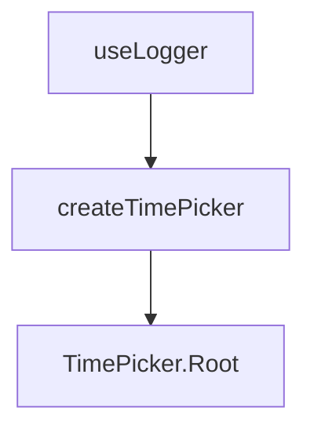

# createTimePicker

<DocsPageFeatures :frontmatter />

Keep a time as separate hour, minute, and optional second fields. The public value stays null until every enabled field has a number.

## Usage

```ts collapse
import { shallowRef } from 'vue'
import { createTimePicker } from '@vuetify/v0'

const value = shallowRef<string | null>(null)
const time = createTimePicker({ value, minuteStep: 15 })

time.commit('hour', 9)
time.value.value // null. The minute is still empty.

time.commit('minute', 58)
time.value.value // '09:45'. Commit goes to the nearest multiple and never wraps.

time.step('minute')
time.value.value // '09:00'. A step wraps past the end of the field.

time.step('minute', -2)
time.value.value // '09:30'

time.grid('minute') // { min: 0, max: 45, step: 15 }

const afternoon = createTimePicker({
  hourCycle: 'h12',
  value: shallowRef('15:00'),
})

afternoon.hour.value // 3
afternoon.period.value // 'pm'
afternoon.commit('period', 'am')
afternoon.value.value // '03:00'
```

## Architecture

`createTimePicker` owns the fields and the canonical string. It reads no DOM, `window`, or date plugin, and reports bad input through `useLogger`. [TimePicker](/components/forms/time-picker) builds its spinbuttons on the returned context.



## Options

| Option | Default | What it does |
|--------|---------|--------------|
| `value` | a new empty ref | Canonical 24-hour string, or null. The picker writes normalized values back to it |
| `hourCycle` | `'h23'` | `'h12'` shows 1–12 and a period. Any other value is read as `'h23'` |
| `seconds` | `false` | When true, the string includes seconds |
| `hourStep` | `1` | Hour interval |
| `minuteStep` | `1` | Minute interval |
| `secondStep` | `1` | Second interval |
| `min` | none | Inclusive lower bound, `HH:mm` or `HH:mm:ss` |
| `max` | none | Inclusive upper bound, same form as `min` |
| `disabled` | `false` | Blocks every edit and every write to `value` |
| `readonly` | `false` | Blocks every edit and every write to `value` |

`hourCycle`, `seconds`, the steps, `min`, `max`, `disabled`, and `readonly` accept a `MaybeRefOrGetter`. `value` is a `Ref<string | null>`. A change to `hourCycle`, `seconds`, a step, or a bound re-applies the step and the bounds to the current value.

### Step grid

Each field moves on the multiples of its step, counted from 0 on the stored 24-hour value: hours inside 0–23, minutes and seconds inside 0–59. `minuteStep: 15` allows 0, 15, 30, and 45.

- `step` moves along the multiples and wraps at either end. With `minuteStep: 15`, stepping up from 0 gives 15, 30, 45, 0, and stepping down gives 45, 30, 15, 0.
- `commit` goes to the nearest multiple and never wraps. `commit('minute', 58)` is 45.
- A fractional step truncates. A non-finite or non-positive step is read as 1. A step larger than the field leaves 0 as its only value.
- In `h12` the hour stays inside the current half of the day. The multiples are still counted on the 24-hour value, so `hourStep: 5` allows 12, 5, and 10 in the morning and 3 and 8 in the afternoon.

`grid(part)` returns the lowest and highest value a numeric field can show and its resolved step, in display values. An `h12` hour reports the range for the current period.

### Step count

`step(part, count)` takes a signed count. The sign is the direction and the magnitude is the number of intervals. The count defaults to 1 and a fractional count truncates. A count of 0 or a non-finite count does nothing.

An empty field lands on its first multiple, whatever the count: 0 for a minute, a second, or an `h23` hour. An empty `h12` hour lands on the first hour of the remembered period, which is 12 with the default step. For `period`, any non-zero count toggles AM and PM.

### Incoming values

A string written to `value` from outside replaces every field. The picker moves each field to its nearest multiple, clamps a complete time into `min` and `max`, and writes the result back in canonical form.

| Incoming | Result |
|----------|--------|
| `'09:50'` with `minuteStep: 15` | `'09:45'` |
| `'09:30'` with `seconds` on | `'09:30:00'` |
| `'09:30:15'` with `seconds` off | `'09:30'` |
| `null` or `''` | Fields empty, value null |
| Anything else, such as `'9:30'` or `'25:00'` | Fields empty, value null, and a development warning |

Turning `seconds` on while the hour and the minute are set keeps the time and sets the second to 0. A second entered through `commit` or `step` is different: with `seconds` on, the value stays null until the second is set.

### Bounds

`min` and `max` apply to a complete value only. A bound wins over the step, so a clamped value can sit off the multiples. A bound that does not parse is ignored. When both parse and `min` is later than `max`, the value is not clamped. Seconds in a bound count only when `seconds` is on.

### Disabled and readonly

While `disabled` or `readonly` is true, `commit`, `step`, and `clear` do nothing, and the picker never writes `value`. That holds at creation, when `value` changes from outside, and when an option changes. The fields show an incoming value as given, without the step or the bounds applied. When the picker is editable again it applies both and writes the result.

### Development warnings

In development the picker logs a warning through [useLogger](/composables/plugins/use-logger) when:

- `value` receives a string that is not a 24-hour `HH:mm` or `HH:mm:ss` time. `null` and `''` are silent.
- `min` or `max` does not parse. That bound is ignored.
- `min` is later than `max`. The range is ignored.

## Reactivity

| Property / method | Reactive | Notes |
| - | :-: | - |
| `value` | <AppSuccessIcon /> | 24-hour string, or null while a field is empty |
| `hour` | <AppSuccessIcon /> | 0–23 in `h23`, 1–12 in `h12`, or null |
| `minute` | <AppSuccessIcon /> | 0–59, or null |
| `second` | <AppSuccessIcon /> | 0–59, or null when seconds are off or unset |
| `period` | <AppSuccessIcon /> | `'am'` or `'pm'` in `h12`, null in `h23`. With an empty hour it is the remembered period |
| `hourCycle` | <AppSuccessIcon /> | Resolved cycle |
| `seconds` | <AppSuccessIcon /> | Whether the string includes seconds |
| `isDisabled` | <AppSuccessIcon /> | Resolved disabled flag |
| `isReadonly` | <AppSuccessIcon /> | Resolved readonly flag |
| `commit` | <AppErrorIcon /> | Sets one field to the nearest multiple of its step. Null clears that field only. A period commit moves a set hour to the other half of the day |
| `step` | <AppErrorIcon /> | Moves one field by a signed number of intervals. Wraps |
| `clear` | <AppErrorIcon /> | Clears every field and resets the period to `'am'`. The value becomes null |
| `grid` | <AppErrorIcon /> | Lowest value, highest value, and step of a numeric field. Reads reactive state, so it tracks inside a getter or a template |

## Examples

::: gn-example
/composables/create-time-picker/alarm.ts 1
/composables/create-time-picker/alarm.vue 2

### Weekday alarm

`useAlarm` owns a 12-hour picker that starts at `09:00` and clamps a complete value between `09:00` and `17:00`. The buttons call `step` with the field name, so the same value can sit behind any markup.

The public value stays null until the hour and the minute are both set. This demo starts complete, so the line shows `09:00` immediately. Set the period to PM and the stored hour shifts by 12, from `09:00` to `21:00`, and the upper bound clamps that to `17:00`. An `h12` hour stays inside its half of the day, so stepping up from 11 AM wraps to 12 AM. That is `00:00`, and the lower bound clamps it to `09:00`. At `17:00` every step up lands past the bound and comes back to it.

`hour` is the 12-hour display number, from 1 to 12. `value` is always the 24-hour string.

| File | Role |
|------|------|
| `alarm.ts` | Creates the picker and returns the fields and `step` |
| `alarm.vue` | Buttons that step the hour, the minute, and the period |
:::

## Recipes

::: gn-example
/composables/create-time-picker/basic

### Quarter-hour steps

`minuteStep: 15` keeps the minute on the quarter hours. Each press of the minute button calls `step('minute')`, so the value's minute reads 00, 15, 30, 45, and then 00 again. The value stays null until both buttons have been pressed once, because the first step on an empty field sets it to its first value.
:::

## FAQ

::: faq

??? Why is the value null until every field is set?

A partial time is not a time string. `commit('hour', 9)` alone leaves `value` null. `commit('minute', 30)` publishes `09:30`. With `seconds`, the second must be set too. `commit(part, null)` clears that one field and the value goes back to null.

??? Does 12-hour mode change the stored string?

`hour` reads 1 through 12, and `value` stays 24-hour. `commit('hour', 3)` is read as 3 in the current period, and a number outside 1–12 is held inside that range. `commit('period', 'pm')` shifts a set hour by 12. 12 AM is 00 and 12 PM is 12.

??? What do min and max do?

They clamp a complete value into the window, and they win over the step. An incomplete value stays null and is not clamped. If both bounds parse and `min` is later than `max`, the clamp is skipped.

??? What happens when disabled or readonly is true?

`commit`, `step`, and `clear` all no-op, and the picker stops writing `value`. An incoming value is shown as given. When both flags are false again, the picker applies the step and the bounds and writes the result.

:::

<DocsApi />
