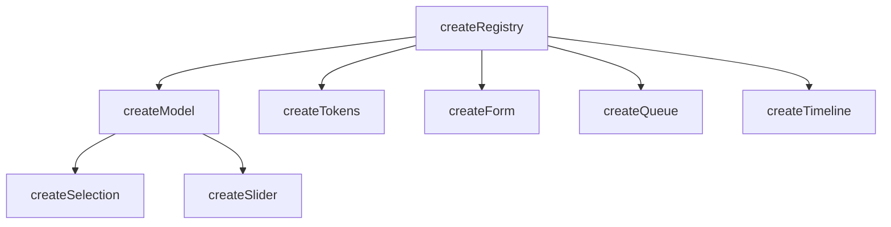
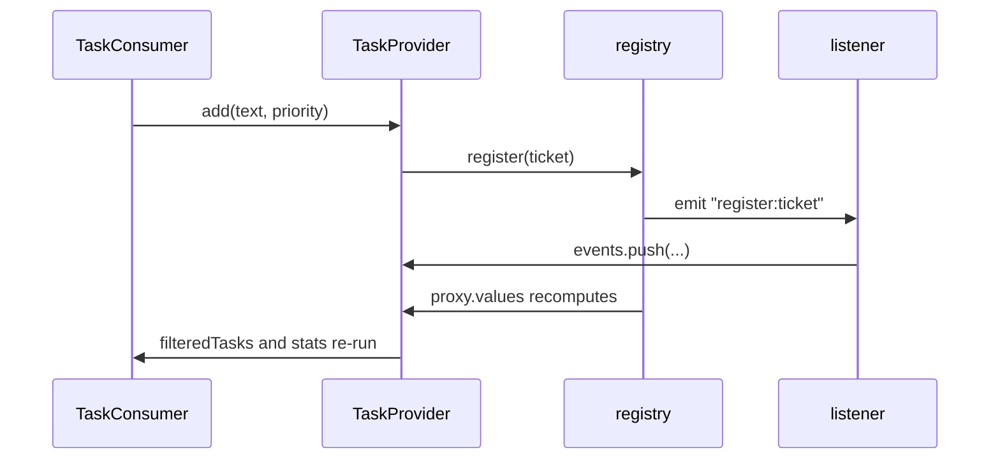

# createRegistry

Foundation for ordered, keyed collections. Items are registered with IDs and indexes, and can be looked up by ID, index, or value.

<DocsPageFeatures :frontmatter />

## Usage

The `createRegistry` composable provides a powerful interface for managing collections of items in a registration-based system. It allows you to register, unregister, and look up items efficiently, while maintaining an index for quick access.

Pass both generics: the input shape you hand to `register()` first, the resolved ticket you read back second. With only the input type, `ticket.value` widens to `string | undefined`; passing the output type alone is reserved for wrappers that fix their own ticket shape, such as `createForm` and `createQueue`.

```ts collapse
import { createRegistry } from '@vuetify/v0'
import type { RegistryTicket, RegistryTicketInput } from '@vuetify/v0'

interface ItemInput extends RegistryTicketInput<string> {
  label: string
}

type Item = RegistryTicket<string> & ItemInput

const registry = createRegistry<ItemInput, Item>()

// Register individual items
const a = registry.register({ value: 'alpha', label: 'Alpha' })
const b = registry.register({ value: 'beta', label: 'Beta' })
const c = registry.register({ value: 'gamma', label: 'Gamma' })

console.log(registry.size) // 3
console.log(a.index)       // 0

// Look up by id
const found = registry.get(b.id)
console.log(found?.label)  // 'Beta'

// Patch a field without replacing the ticket
registry.upsert(b.id, { label: 'Beta (updated)' })

// Move to a new position
registry.move(a.id, 2)
console.log(a.index)       // 2

// Remove one
registry.unregister(c.id)
console.log(registry.size) // 2

// Bulk load
registry.onboard([
  { id: 'x', value: 'x', label: 'X' },
  { id: 'y', value: 'y', label: 'Y' },
])

// Bulk remove
registry.offboard(['x', 'y'])
```

## Context / DI

Use `createRegistryContext` to share a registry across a component tree. Pass a fresh `createRegistry()` to the provider so each app instance owns its registry, created with the same options: what you pass to `createRegistryContext` only configures the module-scope default that a bare `provideItems()` would provide.

```ts
import { createRegistry, createRegistryContext } from '@vuetify/v0'

export const [useItems, provideItems, items] =
  createRegistryContext({ namespace: 'my:items', events: true })

// In the root component — one registry per app instance, with the same options
provideItems(createRegistry({ events: true }))

// In child components
const registry = useItems()
registry.register({ id: 'item-1', value: 'First' })
```

## Architecture

`createRegistry` is the foundation for specialized registration systems:



Each branch extends the base ticket pattern with domain-specific capabilities. See individual composable docs for their extension hierarchies.

## Reactivity

`createRegistry` uses **minimal reactivity by default** for performance. Collection methods are not reactive unless you opt in.

| Method | Notes |
| - | - |
| `register(ticket)` | Append a ticket to the registry; a supplied `index` is ignored — use `move()` to position |
| `unregister(id)` | Remove a ticket by ID |
| `upsert(id, partial)` | Register or update a ticket |
| `move(id, index)` | Move a ticket to a new index position; reindexes only the affected `[from..to]` span |
| `reorder(ids)` | Reorder the registry to match a canonical permutation in one O(n) pass |
| `onboard(tickets)` | Batch-register an array of tickets |
| `offboard(ids)` | Batch-unregister an array of IDs |
| `batch(fn)` | Run multiple mutations with events and the reactive notification deferred to the end |
| `get(id)` | Retrieve a ticket by ID |
| `has(id)` | Check whether a ticket ID is registered |
| `browse(value)` | Reverse-lookup — find ticket ID(s) by value |
| `lookup(index)` | Find ticket ID by zero-based index |
| `seek(direction, from?, predicate?)` | Find `'first'` or `'last'` ticket, optionally starting from an index and/or filtered by predicate |
| `keys()` | All registered IDs as a readonly array |
| `values()` | All registered tickets as a readonly array |
| `entries()` | All `[id, ticket]` pairs as a readonly array |
| `clear()` | Remove all tickets |
| `dispose()` | Remove all tickets and clear event listeners |

> [!TIP] Need reactive collections?
> Pass `{ reactive: true }` to make `keys()`, `values()`, `entries()`, `size`, and per-ticket field reads reactive in templates and computeds. Upserts on existing tickets propagate through the `shallowReactive` wrapping. For event-driven snapshots — or when you want `deep: true` tracking or need reactivity without wrapping the tickets themselves — use [useProxyRegistry](/composables/reactivity/use-proxy-registry) with `{ events: true }`.

## Examples

::: gn-example
/composables/create-registry/context.ts
/composables/create-registry/TaskProvider.vue
/composables/create-registry/TaskConsumer.vue
/composables/create-registry/task-manager.vue

### Task Manager

This example demonstrates the full `createRegistry` lifecycle paired with `createContext` so registry mutations stay encapsulated in the provider and the consumer only sees a reactive `useProxyRegistry` view plus clean, typed methods.



**File breakdown:**

| File | Role |
|------|------|
| `context.ts` | Defines `TaskTicketInput` (extending `RegistryTicketInput`) and `TaskContext`, then creates the `[useTaskRegistry, provideTaskRegistry]` tuple |
| `TaskProvider.vue` | Creates the registry with `events: true`, wraps it in `useProxyRegistry`, wires lifecycle listeners, seeds initial data via `onboard`, and exposes the proxy and mutation methods through context |
| `TaskConsumer.vue` | Calls `useTaskRegistry()` to read `proxy.values` and the mutation methods; owns local UI state (filter, new-task input) and derives `filteredTasks` and `stats` as computed |
| `task-manager.vue` | Entry point—composes `TaskProvider` around `TaskConsumer` |

**Key patterns:**

- onboard — bulk-loads the initial task list in a single batch
- `registry.register()` — adds a ticket with custom fields (`value`, `priority`, `done`)
- `registry.upsert()` — patches a single field without touching the rest of the ticket
- `registry.offboard()` — batch-removes all completed tasks in one call
- `registry.on('register:ticket')` / `on('unregister:ticket')` — reacts to lifecycle events for the audit log
- `useProxyRegistry(registry)` — the registry is `events: true`, so iterate through the proxy's reactive `values` and `size` (or opt into `reactive: true`) rather than a hand-rolled version counter

Add tasks, toggle completion, and filter by priority. Watch the event log at the bottom track every registration change in real time.

:::

## FAQ

::: faq

??? Why is the `index` I pass to `register` ignored?

`register` always appends to the end. A supplied `index` is intentionally ignored — call `move(id, index)` after registering to reposition a ticket, which reindexes only the affected span.

??? Why don't registry reads update reactively in my template?

createRegistry uses minimal reactivity by default for performance. Pass `{ reactive: true }` to make `keys()`, `values()`, `entries()`, `size`, and per-ticket field reads reactive in templates and computeds.

??? What's the difference between createRegistry and createSelection?

createRegistry is the base ordered, keyed collection — registration, indexing, and lookup. [createSelection](/composables/selection/create-selection) extends it (through createModel) with selection state. Use createRegistry when you need to track items but not which are selected.

??? When should I use `{ reactive: true }` vs `useProxyRegistry`?

Pass `{ reactive: true }` to make `keys()`, `values()`, `entries()`, `size`, and per-ticket field reads reactive directly on the registry. Reach for [useProxyRegistry](/composables/reactivity/use-proxy-registry) when you want event-driven snapshots, `deep: true` tracking, or reactivity without wrapping the tickets themselves.

??? How do I run several mutations without notifying subscribers on each one?

Wrap them in `batch(fn)`. Events queue until the callback returns and iteration subscribers are notified once, so a sequence of `register` / `move` / `unregister` calls settles once instead of per mutation. The iteration cache is still cleared per operation, and a reindex deferred by a removal drains when the batch returns, so survivors' `index` is canonical once `batch()` returns.

??? Does unregistering many tickets one at a time scale?

Yes for head-first or tail-first teardown. Locating a ticket is O(1) while its `index` is canonical, and a removal from a registry whose tickets all carry explicit values defers the reindex instead of renumbering survivors on the spot. Survivors' `index` is canonical again at the end of the enclosing `batch()`, after any index-based call (`lookup`, `browse`, `seek`, `move`, `reorder`, `register`, `upsert`), and in all cases in Vue's post-flush queue, which settles before `await nextTick()` resolves. While that reindex is pending, each further `unregister` in the same tick misses its O(1) position check and falls back to an `indexOf` scan. A parent unmounting hundreds of registered children removes them head-first, so the scan finds each ticket at slot 0; tail-first removals never shift anything; both cost one coalesced reindex. Scattered one-by-one removals in a single tick walk about half the list each time, so route those through `offboard(ids)`, which compacts once. Index-derived tickets (no explicit `value`) reindex eagerly on every mid-list removal, so keep those registries small, or bound the mounted count with [createVirtual](/composables/data/create-virtual).

??? Why does the Context / DI snippet pass `createRegistry()` to `provideItems`?

A bare `provideItems()` provides the trinity's module-scope default, which under SSR is shared by every request on the server — see the per-request warning on [createTrinity](/composables/foundation/create-trinity#usage).

:::

<DocsApi />
