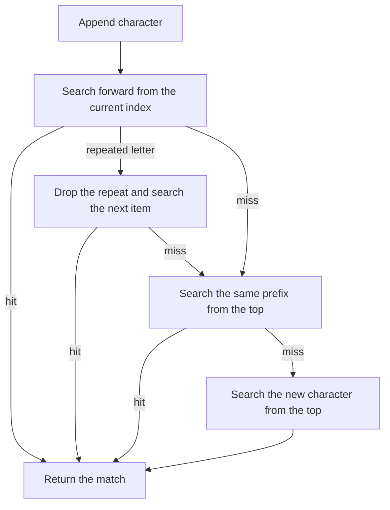

# useTypeahead

<DocsPageFeatures :frontmatter />

Match a list item from characters the user types. Characters within one second form a prefix, and a repeated letter moves to the next match.

## Usage

`useTypeahead` searches a list you supply. It returns the match and leaves selection, menus, and filtering to you.

```ts collapse
import { useTypeahead } from '@vuetify/v0'

const states = ['Alabama', 'Alaska', 'American Samoa', 'Arizona']

const { typeahead, reset } = useTypeahead(() => states, {
  text: state => state,
  duration: 1000,
})

typeahead('a') // { item: 'Alabama', index: 0 }
typeahead('m') // { item: 'American Samoa', index: 2 }
reset()
```

## Architecture



Each call restarts a one-second timer. When the timer fires, the buffer is cleared. `reset()` clears it immediately.

## Options

| Option | Type | Default | Description |
| --- | --- | --- | --- |
| `text` | `(item: T) => string` | — | Text used for prefix matching. Read on every key. Not trimmed. |
| `duration` | `MaybeRefOrGetter<number>` | `1000` | Inactivity window, in milliseconds, before the buffer clears. |

## Examples

::: gn-example
/composables/use-typeahead/states.ts
/composables/use-typeahead/StateList.vue
/composables/use-typeahead/prefix.vue

### Prefix matching

Click the list and type. `a` lands on Alabama. A second letter within one second extends the prefix, so `m` moves to American Samoa. The same letter again, with no longer prefix to honor, cycles to the next item that starts with that letter. Alabama, then Alaska, then American Samoa, then Arizona, then back to Alabama.

The composable only reports the match. This example writes that string into a `shallowRef` and marks the row. It does not filter the list, skip entries, or open anything. A static array is enough when the rows do not change. Pass `text` that reads the field you want to match, and decide in the key handler what a hit means: highlight a row, update a value, or ignore it. The buffer lives until the window from [useTimer](/composables/system/use-timer) elapses, or until you call `reset()`.

| File | Role |
| --- | --- |
| `states.ts` | Name and postal code for each state |
| `StateList.vue` | Renders the listbox rows and marks the current match |
| `prefix.vue` | Owns `useTypeahead`, the key handler, and the match ref |

:::

::: gn-example
/composables/use-typeahead/fruits.ts
/composables/use-typeahead/FruitList.vue
/composables/use-typeahead/roster.vue

### Registry items

The items getter runs on every character and reads whatever is registered then. This example stores fruit in a [createSelection](/composables/selection/create-selection) opened with `events: true`. [useProxyRegistry](/composables/reactivity/use-proxy-registry) exposes those tickets as `items.values`, which the list renders and the getter returns. [useProxyModel](/composables/reactivity/use-proxy-model) keeps a ref on that same selection: assigning the ref selects the matching ticket, and selecting a ticket assigns the ref.

Click Jump and type. A hit calls `select`. The ref updates from the selection, the banner shows that fruit, and its row is marked. Remove the selected fruit and the selection drops its id, so the ref clears through the same proxy. Add Apricot again and it registers last, which the numbered list shows. After the buffer clears, typing `a` walks Avocado, then Apricot.

| File | Role |
| --- | --- |
| `fruits.ts` | Names onboarded into the selection |
| `FruitList.vue` | Renders registration order and marks the selected ticket |
| `roster.vue` | Selection, both proxies, membership toggles, and the typeahead handler |

:::

## FAQ

::: faq

??? Does useTypeahead select an item or open a menu?

No. `typeahead` returns `{ item, index }` or `undefined`. Updating a model, moving highlight, and opening a list are the caller's job.

??? Are disabled items skipped?

No. Whatever `items` returns is searched, in that order. Filter the list before passing it if some entries should not match.

??? What does a repeated letter do?

If the last two buffered characters are the same and that prefix misses, the extra character is dropped and the search continues at the next index. An item that actually starts with the doubled prefix, such as `aa` on Aardvark, stays a prefix match and does not cycle.

??? When does the buffer clear?

After `duration` milliseconds without another character (one second by default), or when you call `reset()`. Arrow keys and closing a list do not clear it unless you reset it yourself.

:::

<DocsApi />
