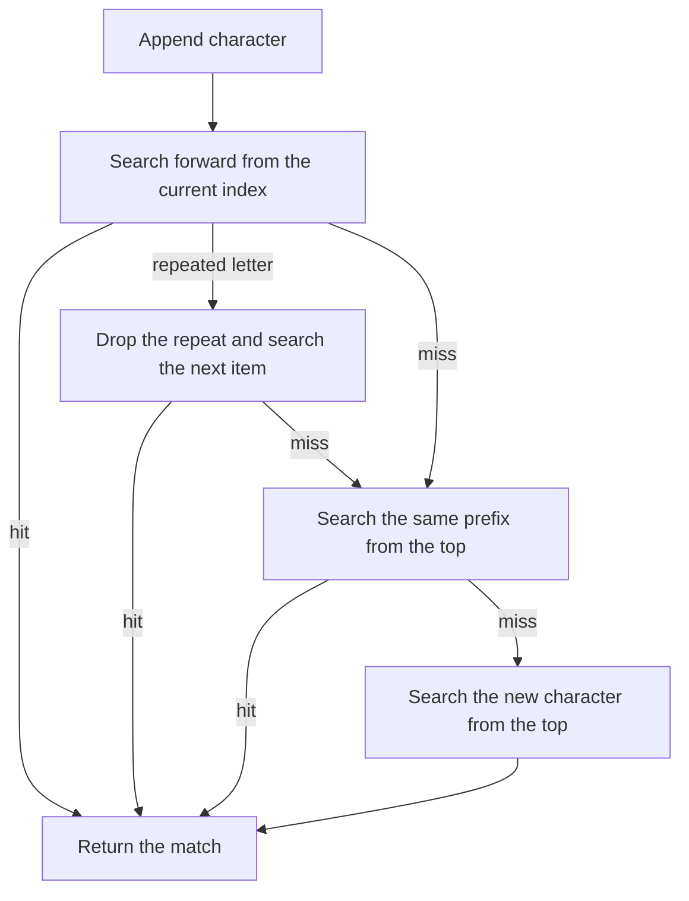

# useTypeahead

<DocsPageFeatures :frontmatter />

Match a list item from characters the user types. Characters within one second form a prefix, and a repeated letter moves to the next match.

## Usage

`useTypeahead` searches a list you supply. It returns the match and leaves selection, menus, and filtering to you.

```ts collapse
import { useTypeahead } from '@vuetify/v0'

const states = ['Alabama', 'Alaska', 'American Samoa', 'Arizona']

const { typeahead, reset } = useTypeahead(() => states, {
  text: state => state,
  duration: 1000,
})

typeahead('a') // { item: 'Alabama', index: 0 }
typeahead('m') // { item: 'American Samoa', index: 2 }
reset()
```

## Architecture



Each call restarts a one-second timer. When the timer fires, the buffer is cleared. `reset()` clears it immediately.

## Options

| Option | Type | Default | Description |
| --- | --- | --- | --- |
| `text` | `(item: T) => string` | — | Text used for prefix matching. Read on every key. Not trimmed. |
| `duration` | `MaybeRefOrGetter<number>` | `1000` | Inactivity window, in milliseconds, before the buffer clears. |

## Examples

::: gn-example
/composables/use-typeahead/basic

### Prefix matching

Focus the button and type. `a` lands on Alabama. A second letter within one second extends the prefix, so `m` moves to American Samoa. The same letter again, with no longer prefix to honor, cycles to the next item that starts with that letter — Alabama, then Alaska, then American Samoa, then Arizona, then back to Alabama.

The composable only reports the match. This example writes the matched string into a `shallowRef` and renders it. It does not filter the list, skip entries, or open anything. Pass `text` that reads the field you want to match, and decide in the key handler what a hit means — highlight a row, update a value, or ignore it. The buffer lives until the window elapses or you call `reset()`.

:::

::: gn-example
/composables/use-typeahead/registry

### Registry items

The items getter runs on every character, so the search sees the tickets registered at that moment. This example stores the states in a [createRegistry](/composables/registration/create-registry) and passes `() => available.values()`. Select reads its options the same way: the getter returns the tickets currently in the list.

The four states start registered. Click a name to remove it or put it back. The list under the buttons is registry order, which is the order a repeated letter cycles through. Remove Alabama and type `a`. The match is Alaska. Add Alabama again and it is registered last. After the buffer clears, typing `a` four times walks Alaska, American Samoa, Arizona, then Alabama.

`reactive: true` redraws the buttons and the list when a state is added or removed. The getter reads `values()` on the keypress, so the search uses those same tickets. Removing the state shown as the match clears that label. The buffer stays, and the next character continues the prefix against the tickets that remain.

:::

## FAQ

::: faq

??? Does useTypeahead select an item or open a menu?

No. `typeahead` returns `{ item, index }` or `undefined`. Updating a model, moving highlight, and opening a list are the caller's job.

??? Are disabled items skipped?

No. Whatever `items` returns is searched, in that order. Filter the list before passing it if some entries should not match.

??? What does a repeated letter do?

If the last two buffered characters are the same and that prefix misses, the extra character is dropped and the search continues at the next index. An item that actually starts with the doubled prefix, such as `aa` on Aardvark, stays a prefix match and does not cycle.

??? When does the buffer clear?

After `duration` milliseconds without another character (one second by default), or when you call `reset()`. Arrow keys and closing a list do not clear it unless you reset it yourself.

:::

<DocsApi />
